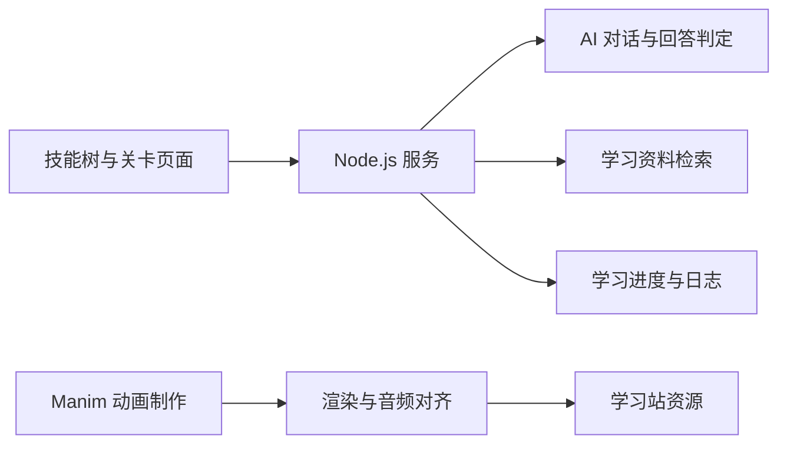

# MM-QUEST 多模态学习闯关

[返回项目索引](https://github.com/18538205298/project-portfolio)

## 项目概览

将 AI 知识学习组织为技能树和闯关练习，结合 AI 导师对话、回答判定、学习进度与日志。重点是学习交互和知识组织方式。

**技术栈**：Node.js 原生 HTTP、JavaScript、Web 页面；配套动画制作使用 Python、Manim、FFmpeg 和 Shell。

## 功能组成

- **技能树与关卡**：按知识路线组织学习内容。
- **AI 导师与练习**：围绕学习主题进行对话与回答判定。
- **资料检索**：从学习资料中组织相关信息。
- **进度与日志**：记录学习进度与学习过程。
- **语音接口**：为语音相关交互提供接口。
- **配套动画流程**：场景制作、批量渲染、队列处理、音频对齐与资源导出。

## 结构概览

## 技术要点

- 学习路线如何映射为关卡和技能树。
- AI 导师、练习判定和学习记录如何配合。
- 资料检索结果如何保留来源。
- 动画制作如何从单段渲染扩展为批量流程。

## 展示范围

这里仅介绍应用功能与制作流程。课程资料、论文配图、知识库原文、视频、配音和美术素材的公开范围按各自授权确认。AI 相关知识和论文方法的归属保留给原作者。

## 关键代码

- `samples/session-store.js`：来自原项目 `mm-quest/public/app/session-store.js`。
- `samples/selfcheck.js`：来自原项目 `mm-quest/public/app/selfcheck.js`。

这些文件保留原项目中的核心逻辑，供阅读和交流。完整应用还包含其余模块、依赖与运行配置。
